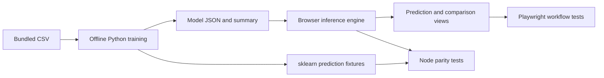

# Vine — Wine intelligence

Vine helps wine analysts explore how laboratory measurements relate to sensory quality. Enter a red-wine chemistry profile, receive an immediate model estimate, and compare two saved profiles alongside the measurements that differ. The Data & evidence view puts the estimate in context with the source distribution, correlations, and held-out model errors.

Predictions run in browser JavaScript against exported, fitted models. The static frontend has no runtime package dependencies, API keys, inference server, or CDN requirement. Python is used for offline training; Node and Playwright are development tools for verification.

**Public app address:** [jzzyla.github.io/talentsource-demo](https://jzzyla.github.io/talentsource-demo/)  
**Registered repository:** [jzzyla/talentsource-demo](https://github.com/jzzyla/talentsource-demo)  
**Verification status:** local Chrome workflows and inference checks passed on November 12, 2026. Successful public deployment is not established by those checks. See [Validation](VALIDATION.md) for evidence and boundaries.

## Evidence map

| Assessment perspective | Evidence to inspect | Current boundary |
| --- | --- | --- |
| Product thinking | The workflow and decision tables below; [profile comparison implementation](app.js). | Clear laboratory-profile use case; no completed user research. |
| Design thinking | [Interface](index.html), [responsive styles](style.css), visible field guidance, and [browser workflows](tests/browser/workflows.spec.js). | Local desktop/mobile and keyboard checks; no comprehensive accessibility audit. |
| Engineering | [Inference engine](inference.js), [unit/regression tests](tests/inference.test.js), [browser tests](tests/browser/workflows.spec.js), and lockfile. | Recorded local passes; fresh CI execution is separate evidence. |
| Data science | [Training/export pipeline](scripts/train.py), [recorded evaluation](models/summary.json), and [model card](MODEL_CARD.md). | Duplicate-grouped holdout with baseline; no external validation or fresh retraining in the latest review. |
| Solution architecture | Component boundaries below, static exported assets, and [publishing workflow](.github/workflows/pages.yml). | Browser inference verified locally; public deployment requires its own check. |

## Start locally

From the repository root:

```sh
python3 -m http.server 8080
```

Open [localhost:8080](http://localhost:8080). The bundled models and data are ready to use; Python ML dependencies and npm installation are unnecessary to use the frontend. Serve the files over HTTP: opening `index.html` directly as a file prevents reliable module and JSON loading.

For development and testing, use Node.js 22, npm, and Python 3.11 or later. Local browser tests also require installed Google Chrome. The deployed frontend only needs a browser supporting JavaScript modules and `fetch`.

## Product purpose and workflow

The intended user has a laboratory analysis of a red wine and wants to compare its estimated sensory score with another measured profile. Eleven chemical inputs make this a laboratory-oriented workflow rather than a recommendation based on wine names or brands. A name entered in the application labels a saved profile; it never becomes a model input.

1. **Prediction studio:** edit the 11 measurements, using the visible units, field explanations, and observed ranges. Defaults are training-set medians. Estimates update automatically while every measurement is valid.
2. **Inspect the result:** choose random forest, ridge regression, or the mean baseline. Read its holdout error and limitations alongside the estimate. Empty or invalid fields clear the score; out-of-range values show a warning.
3. **Compare Wines:** optionally name a profile and select **Save as Wine A**. Enter another profile and select **Save as Wine B**, then open **Compare Wines**. Both snapshots use the same comparison model. Cards show estimates and aggregate MAE; the table highlights changed measurements and reports B minus A in the displayed units.
4. **Refine a comparison:** **Edit profile** loads a saved snapshot into the studio. Make changes and save to the intended A/B slot again. Editing the current inputs does not silently change saved snapshots. Profiles can be removed and are cleared when the page reloads.
5. **Data & evidence:** inspect the score distribution, signed chemistry correlations, validation method, seed, and model comparison before interpreting a small score difference.

A reproducible walkthrough is to keep the initial defaults, save Wine A, change alcohol from **10.1** to **12 % vol.**, and save Wine B. With the bundled forest, the displayed score changes from **5.73** to **6.03**; comparison reports approximately **0.30** quality points and highlights alcohol. These are model estimates, not observed sensory ratings for two actual wines.

## Design decisions and tradeoffs

| Decision | Purpose and tradeoff |
| --- | --- |
| Automatic prediction, explicit saving | Input changes have immediate feedback; saved comparisons remain deliberate snapshots. |
| Units and explanations beside every field | Analysts can enter values consistently without guessing units or opening a tooltip. Reporting bases are explicit. |
| Same model for both comparison profiles | Differences in the selected model do not get confused with differences between wines. The studio and comparison model selectors are independent. |
| Visible model errors and limitations | A score is accompanied by evaluation context; MAE and R² are never presented as confidence in an individual wine. |
| Warn on observations outside the dataset range | Supports exploratory use without silently treating extrapolation as validated. This does not detect every chemically implausible combination. |
| Responsive layout and native controls | Inputs have associated labels and descriptions; tabs support arrows, Home, and End; status messages use live regions. Tests cover desktop and 390px mobile layouts. Full accessibility conformance has not been established. |
| Profiles kept in memory | No account, database, or profile upload is needed. Reloading loses saved profiles; persistence and export are future work. |

Measurement units follow [Cortez et al., Table 1](https://projects.csail.mit.edu/wiki/pub/Evodesign/SensoryEvaluationsDatabase/winequality09.pdf#page=5). Labels use L in place of dm³, which has the same volume; model inputs are not rescaled. Density uses g/cm³, pH is unitless, and alcohol is % vol. The reporting bases for acidity, chlorides, and sulphates appear beside their fields. See [measurement-info.js](measurement-info.js).

## Data, modeling, and validation

The included [red-wine CSV](data/winequality-red.csv) contains **1,599 rows**, **11 physicochemical predictors**, and the `quality` target. It describes Portuguese Vinho Verde red wines. Quality is an ordinal sensory rating on a 0–10 scale; the observed red-wine labels run from 3 to 8. The implementation treats the target as continuous regression and excludes `quality` from the feature matrix.

The [training script](scripts/train.py) groups identical 11-feature vectors before splitting. `GroupShuffleSplit`, **seed 42**, holds out 20% of the **1,359 unique feature groups**, producing **1,270 training rows** and **329 validation rows**. Group sizes differ, so the row split is not exactly 80/20. The script asserts disjoint groups to prevent exact duplicate chemistry profiles leaking between training and validation. Unknown vineyard, batch, or temporal relationships are not controlled by this grouping.

Every estimator fits on training rows only. Ridge standardization is also fitted only on training data. Defaults are training medians. Full-data ranges, label counts, and correlations are descriptive display statistics and do not enter model fitting. Hyperparameters are fixed in code; the script does not search or tune against the holdout, and the exported models are not subsequently refitted on all rows.

| Model | Configuration / rationale | MAE ↓ | RMSE ↓ | R² ↑ |
| --- | --- | ---: | ---: | ---: |
| Mean baseline | Training mean for every profile; establishes a reference | 0.670 | 0.786 | -0.010 |
| Ridge regression | Training-fitted StandardScaler + Ridge, alpha 10; inspectable linear relationship | 0.505 | 0.630 | 0.351 |
| Random forest | 60 trees, max depth 9, minimum leaf size 3, seed 42; captures nonlinear interactions | 0.499 | 0.639 | 0.333 |

Results are rounded from [models/summary.json](models/summary.json). Forest has the lowest MAE on this split, about **25.5% lower than the baseline**, which supports its default selection. Ridge has the lower RMSE and higher R². The small forest/ridge MAE gap does not establish a universal winner or statistical significance.

MAE measures average absolute error in sensory quality points. RMSE gives larger mistakes more weight. R² compares squared error against predicting the validation-set mean; a negative baseline R² is possible because the baseline predicts the training mean. These are predictive-performance metrics, separate from any challenge work-quality assessment.

The dataset is imbalanced: **1,319 of 1,599 wines have quality 5 or 6**. Alcohol has a positive full-data Pearson correlation with quality (approximately 0.48), while volatile acidity has a negative one (approximately −0.39). These associations describe the dataset; they do not establish causation or explain an individual forest prediction. Aggregate metrics do not establish performance on rare scores.

See the [model card](MODEL_CARD.md) for feature order, uncertainty, and population limits.

## Architecture and inference consistency



| Component | Responsibility |
| --- | --- |
| [scripts/train.py](scripts/train.py) | Split, fit, evaluate, and export models plus fixtures and summary. |
| [models/](models/) | Frozen baseline, ridge, and forest artifacts; feature order, preprocessing parameters, and evaluation metadata. |
| [inference.js](inference.js) | Pure prediction engine shared by browser and Node tests. Evaluates exported parameters without requiring Python. |
| [app.js](app.js) | Load assets, construct inputs, validate profiles, update estimates, and manage comparison snapshots. |
| [measurement-info.js](measurement-info.js) | Units and field descriptions, separate from fitted parameters. |
| [index.html](index.html), [style.css](style.css) | Semantic interface structure, responsive presentation, and visible explanations. |
| [tests/](tests/) | Export parity, inference validation, and browser workflows. |

Ridge uses the exported training means, scales, coefficients, and intercept. Forest inference casts input values to float32, matching sklearn's tree input representation, then traverses exported thresholds and averages leaf predictions. Baseline inference returns the exported training mean. Feature order is consistent across the schema and all artifacts.

The engine rejects incorrect input lengths, nonnumeric values, and non-finite inputs. It also rejects non-finite outputs and forest inputs that overflow float32. The interface clears an unusable score, explains the problem, and recovers when inputs are corrected. Saving checks that a profile can be evaluated by every available comparison model. A missing model file produces a visible loading error.

The application fetches static assets and performs prediction locally. It has no measurement-upload endpoint, analytics integration, or secret configuration. Hosting still receives ordinary asset requests; following a citation link navigates to an external source.

## Reproduce training

Python ML dependencies are pinned in [requirements.txt](requirements.txt). From the repository root:

```sh
python3 -m venv .venv
. .venv/bin/activate
python -m pip install -r requirements.txt
python scripts/train.py
npm test
```

The script regenerates all three model artifacts, `models/summary.json`, and `tests/parity-fixtures.json`. Keep those generated outputs together when changing a model. The summary records sklearn version, seed, split counts, feature schema, metrics, and the dataset SHA-256. The stored sklearn version is **1.8.0**.

Bundled source CSV SHA-256:

```text
4a402cf041b025d4566d954c3b9ba8635a3a8a01e039005d97d6a710278cf05e
```

Fresh Python retraining was **not rerun during the latest local validation** because ML packages were absent from that environment. The commands and pinned dependencies are supplied for reproduction; passing checks against bundled fixtures is narrower evidence than independently regenerating all artifacts.

## Tests and observed local behavior

Run inference checks with Node, without npm dependencies:

```sh
npm test
```

Run browser workflows with installed Google Chrome:

```sh
npm ci
npm run test:browser
```

[Playwright configuration](playwright.config.js) starts its own local Python server on **8091**; that port must be available. It runs each workflow at desktop and **390 × 844** mobile viewport sizes. No existing development server is needed.

| Evidence | Observed result on November 12, 2026 | Scope |
| --- | --- | --- |
| [Inference tests](tests/inference.test.js) | **4 tests passed** | Includes 90 stored sklearn prediction comparisons, absolute tolerance below 1e-9; target exclusion and feature-order consistency; invalid inputs; numeric overflow. |
| [Browser tests](tests/browser/workflows.spec.js) | **10 checks passed** | Five workflows at two viewport sizes: automatic estimates and units, invalid/overflow recovery, comparison snapshots and editing, keyboard/evidence/layout checks, and missing-model errors. |
| [Validation record](VALIDATION.md) | Local Chrome checks recorded | Includes observed prediction examples and manual verification guidance. |

Browser tests exercise the interface, not just the prediction function. A changed alcohol input updates the estimate without submitting a form; an empty measurement clears it; an extreme overflow case shows a corrective message; changing unsaved inputs leaves saved comparison snapshots intact.

CI uses Playwright's Chromium rather than installed Chrome. To run that configuration locally on a supported system:

```sh
npm ci
npx playwright install --with-deps chromium
CI=true npm run test:browser
```

Passing local tests does not establish cross-browser support, complete accessibility conformance, public availability, or performance outside the dataset. CI results must be checked separately after a workflow runs.

## GitHub Pages publication

Publishing source: **GitHub Actions**, configured in [.github/workflows/pages.yml](.github/workflows/pages.yml), triggered by pushes to `main` or a manual run.

1. In the registered repository's **Settings → Pages**, select **GitHub Actions**.
2. The workflow checks out source, selects Node 22, runs `npm ci`, executes inference tests, installs Chromium, and executes browser tests.
3. It assembles `_site` from `index.html`, `style.css`, `app.js`, `inference.js`, `measurement-info.js`, `.nojekyll`, and `models/`. There is no compilation step or deployed inference service.
4. It uploads and deploys that static artifact. Relative module, stylesheet, and model paths support the `/talentsource-demo/` project subpath.
5. Open the published address in a fresh browser tab and confirm asset loading, automatic prediction, Data & evidence, and Compare Wines. Record actual deployment success separately from local verification.

The expected address is [https://jzzyla.github.io/talentsource-demo/](https://jzzyla.github.io/talentsource-demo/). Current evidence here establishes local behavior, not a successful public deployment. This README edit does not publish the application.

## Limitations and next steps

- Validation uses one fixed grouped holdout, without cross-validation, external validation, or calibrated prediction intervals. Do not repeatedly tune against it and continue calling it untouched.
- Rare quality scores have few examples. A future evaluation should inspect errors by observed quality and measurement range, and quantify variability before choosing a model based on small metric differences.
- Models represent a narrow Portuguese red-wine population. Application to other regions, white wines, or other styles requires separate evidence.
- Estimates are continuous and not clipped to 0–10. A linear prediction can leave that scale; the visual marker is bounded to the display range while the numeric output remains raw.
- Out-of-range warnings operate on each measurement independently. They do not detect all implausible combinations or erroneous laboratory units.
- The model does not establish food safety, health effects, purchasing suitability, or a causal recipe for improving taste. A higher comparison estimate is not proof of a better wine.
- No completed user research or comprehensive screen-reader/cross-browser audit is claimed. Profile persistence, CSV import/export, and a more visible mobile result summary are potential workflow improvements.

## Tools, provenance, and challenge context

Implementation and revisions used **OpenAI Codex through user prompts**. This session began with an existing application and exported model assets. No third-party UI template is used. Training uses NumPy and scikit-learn; verification uses Node's test runner and Playwright; hosting configuration uses official GitHub Actions. See [package-lock.json](package-lock.json), [requirements.txt](requirements.txt), and [LICENSE](LICENSE).

The supplied challenge guide is mapped to implementation evidence in [PUBLIC_BRIEF.md](PUBLIC_BRIEF.md). Its rules require solution work during the official attempt. This documentation does not establish that pre-existing assets satisfy that condition. Repository visibility, server-recorded timing, and submission eligibility require separate evidence. Predictive metrics, work-quality assessment, and the published speed bonus are distinct; no internal scoring weights or guaranteed score are claimed.

## Dataset attribution and licensing

Cortez, P., Cerdeira, A., Almeida, F., Matos, T., & Reis, J. (2009). *Wine Quality* [Dataset]. UCI Machine Learning Repository. [doi:10.24432/C56S3T](https://doi.org/10.24432/C56S3T).

The original UCI red-wine CSV is bundled unchanged under [CC BY 4.0](https://creativecommons.org/licenses/by/4.0/). Models and statistical summaries are derived from it. See [data/NOTICE.md](data/NOTICE.md) for the source archive and attribution. Application code is [MIT licensed](LICENSE); that license does not replace the dataset's license. Attribution does not imply endorsement by the dataset authors or challenge organizer.
